# ZurichJS Conf retrospective · slides

The slides for **ZurichJS Conf retrospective**, a 40-minute talk on how ZurichJS Conf 2026 was pulled off. It's a code-driven deck: every slide is painted on one canvas and shown either full screen or on the projector inside a 3D rebuild of the venue, Technopark Zürich, as it was on the day.

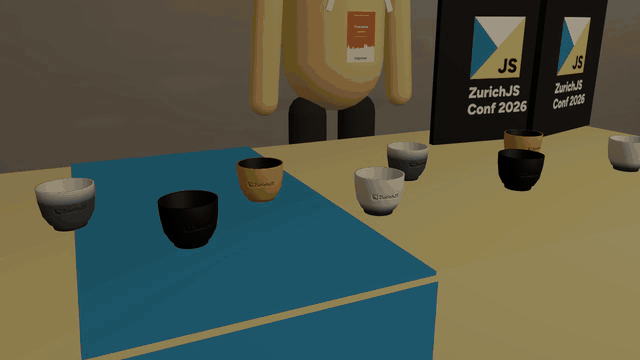

> **Status: draft.** The 3D venue and the slide blocks are in place. The storyline is being reworked with the team in [`docs/storyline.md`](docs/storyline.md).

## The venue

Moving between slides walks the camera through the venue at eye level, through the booth window, the back doors and the hallway, with no cuts.

| | |
|---|---|
| 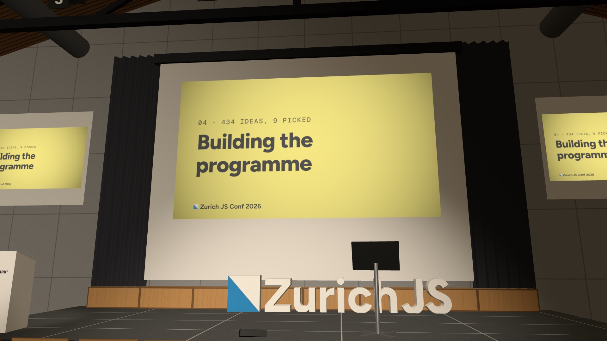 **Stage**: the main screen, podium and foam letters | 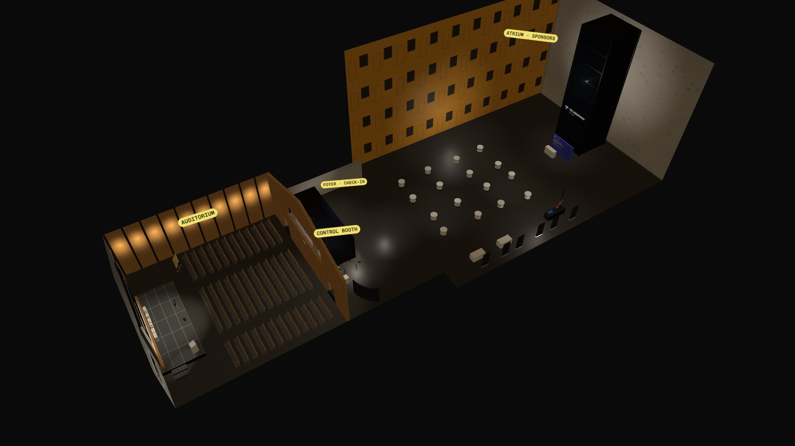 **Map**: the whole venue as a labelled cutaway |
| 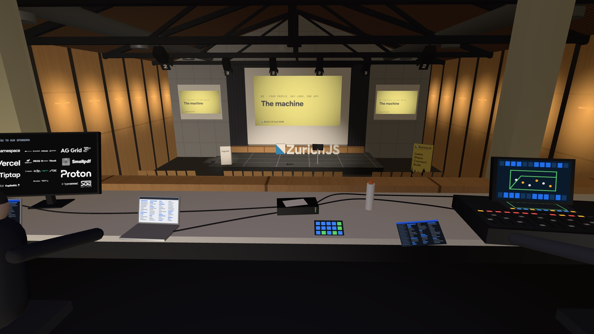 **Control booth**: the crew, sponsor loop and mixer | 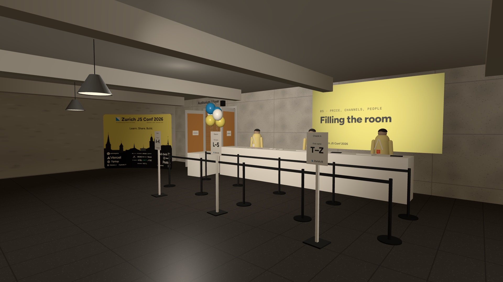 **Foyer**: check-in, with the slide projected on the wall |
| 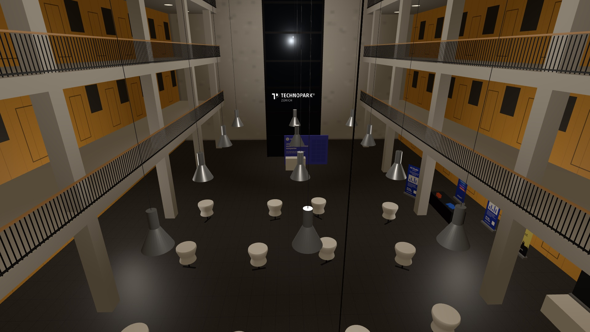 **Atrium**: galleries, lift tower and cocktail tables | 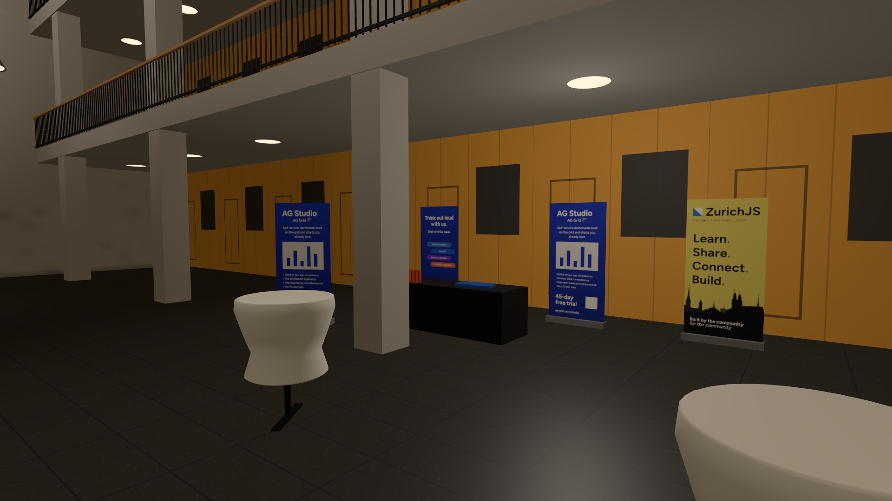 **Sponsor booths** |
| 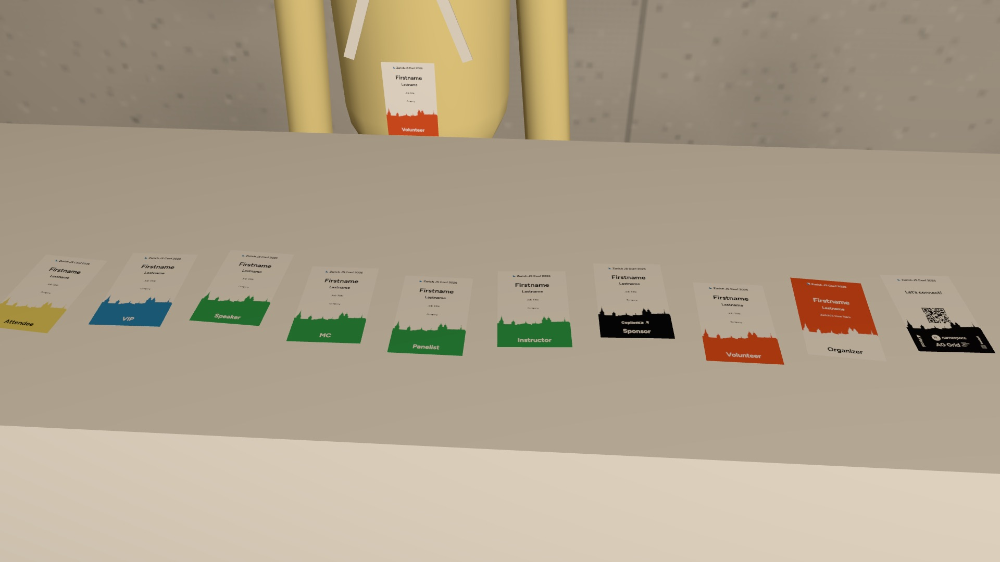 **Badges**: all nine kinds | 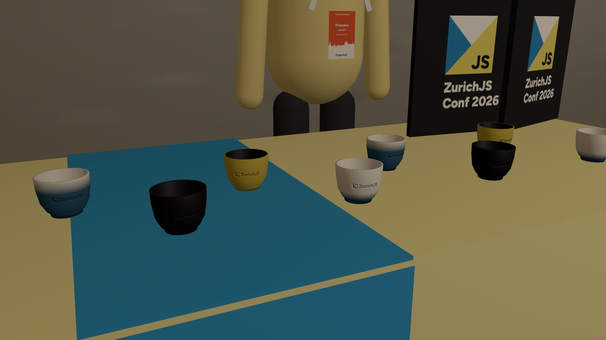 **Merch**: engraved cups and totes |

## The slides

| | |
|---|---|
| 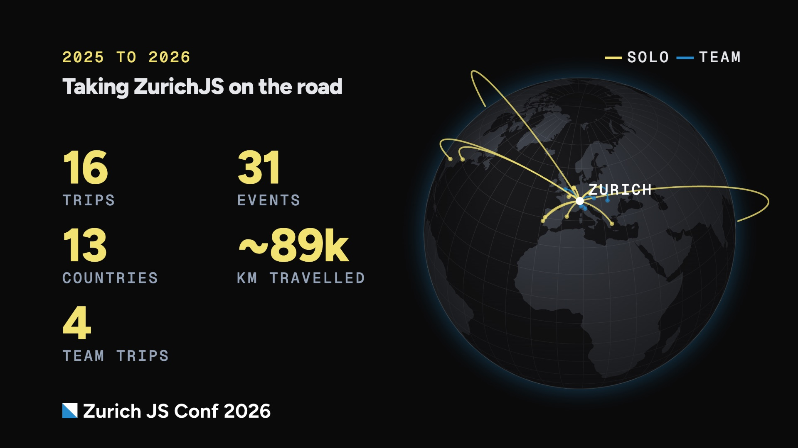 **Road to Zurich**: every trip before the conference, on a globe | 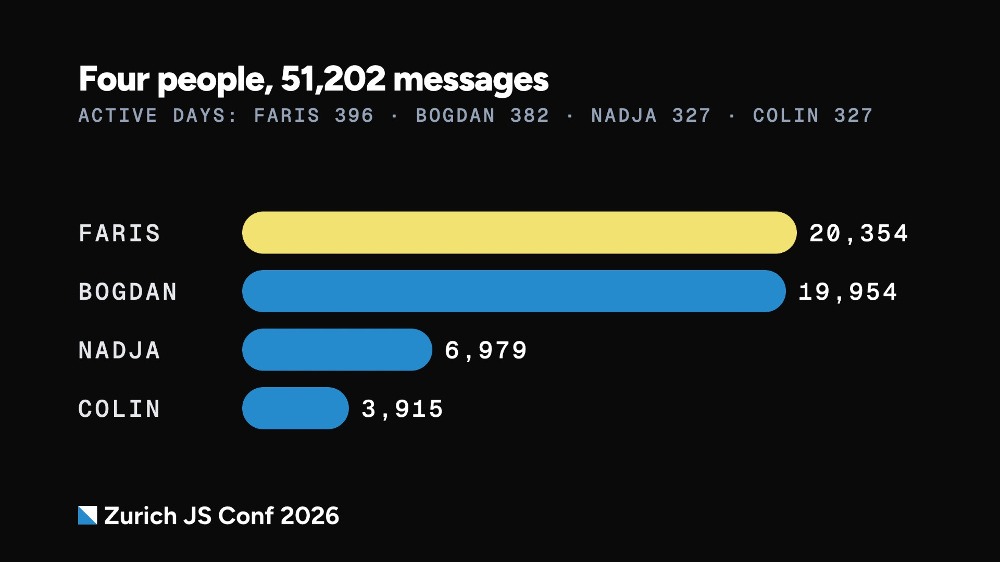 **Charts and numbers**, in the ZurichJS Conf brand |

## Run it

Needs Node 24 and pnpm (the version is pinned in `package.json`).

```bash
pnpm install
pnpm dev            # http://localhost:5180
pnpm build          # typecheck + production build into dist/
```

| Key | Does |
|---|---|
| `→` / `←` | Next / previous slide |
| `Enter` / `Backspace` | Next / previous step within a slide |
| `0`–`9` | Jump to a slide |
| `f` | Fullscreen |

| URL | Does |
|---|---|
| `?slide=<id>` | Open a slide (`&step=<n>` for a step) |
| `?flat` | 2D only, no 3D venue |
| `?presenter` | Speaker notes, next slide and timer. Open in a second window; it stays in sync |
| `?index` | Every slide in a grid |
| `?cue=<view>` | Force one venue view, e.g. `?cue=booth` |
| `?still` | No animation (screenshots) |

## Editing the talk

- **Running order:** `src/content/slides.ts`
- **What each slide shows:** `src/content/visuals.ts`
- **Road-to-Zurich trips:** `src/content/travel.ts`
- **Brand tokens:** `src/brand/tokens.ts`

Slides are plain data, and the venue views are named camera positions. See [`AGENTS.md`](AGENTS.md) for the rules and [`CONTEXT.md`](CONTEXT.md) for the vocabulary.

## Pull requests

Every PR needs **screenshots** and a **screen recording** of what it adds. CI blocks the PR without them. Keep descriptions short: what changed and why.

```bash
pnpm build && pnpm preview --port 5181 &
pnpm shot   "http://localhost:5181/?still&slide=<id>" out.png        # add &flat for 2D
pnpm record "http://localhost:5181/?slide=<id>" out.mp4 --keys "ArrowRight:3000"
```

Then drag the files into the PR description.

## Deploy

Netlify builds `pnpm build` and publishes `dist/` (see `netlify.toml`). Everything is bundled: fonts, logos, photos and map data are local, so the deck runs offline on conference Wi-Fi.
